# Quản Lý Quỹ Đội Bóng ⚽

Ứng dụng quản lý tài chính cho đội bóng đá phong trào. Theo dõi đóng quỹ, thu chi, mã QR chuyển khoản và tự ghi nhận chuyển khoản ngân hàng — tất cả trong một giao diện đơn giản, dễ sử dụng.

Mọi trang đều xem công khai; chỉ admin đăng nhập mới được thêm/sửa/xóa.

> **Ban Ban FC** — Được xây dựng bởi đội bóng, cho đội bóng.

## Screenshots

### Đăng nhập
Bảo mật bằng tài khoản admin — chỉ người được phân quyền mới có thể thao tác dữ liệu.

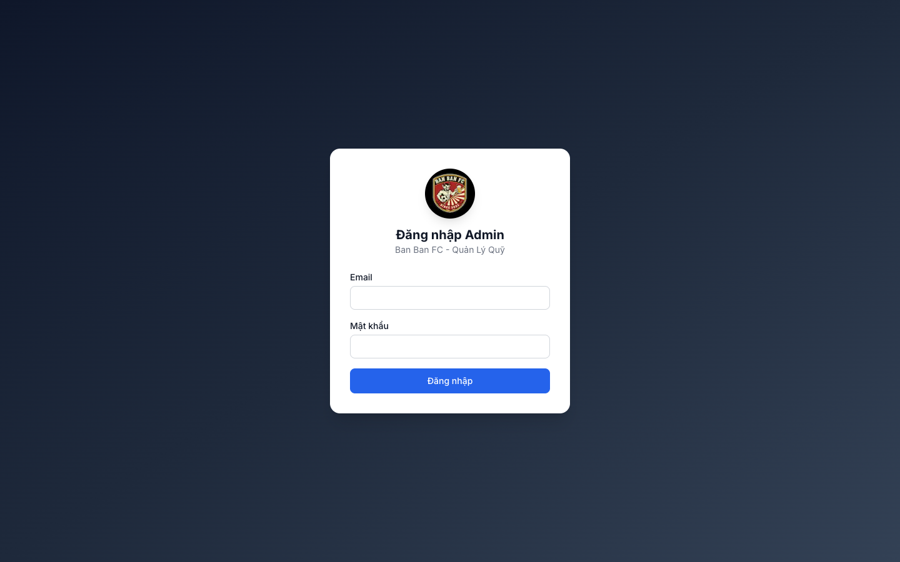

### Tổng quan (Dashboard)
Xem nhanh tình hình tài chính: tổng thu, tổng chi, số dư còn lại, biểu đồ thu chi theo tháng và các giao dịch gần đây.

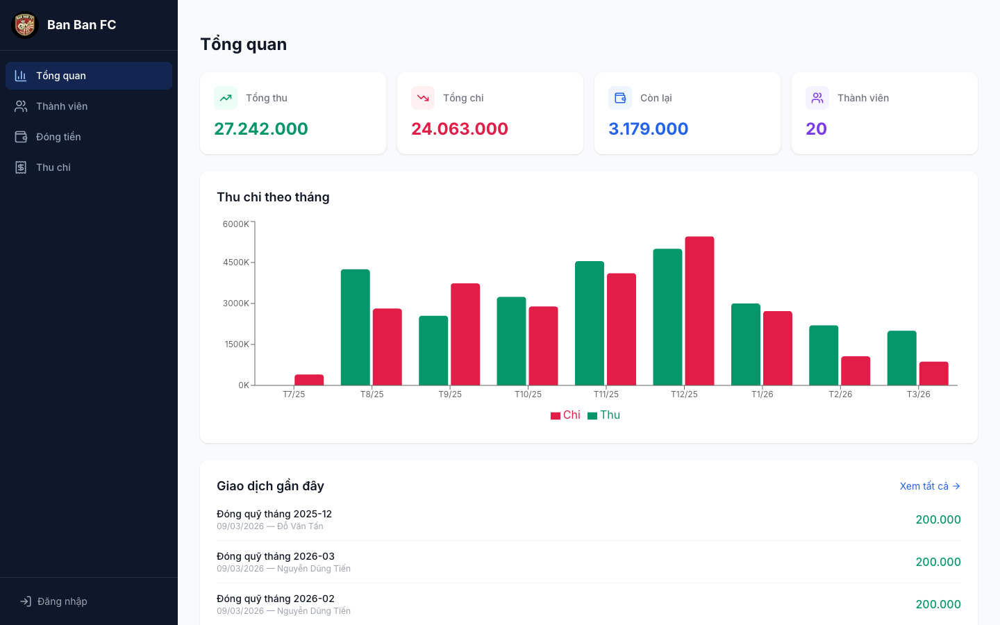

---

### Phân quyền: Admin vs Thành viên

Ứng dụng phân biệt rõ 2 chế độ xem:

| | Thành viên (chưa đăng nhập) | Admin (đã đăng nhập) |
|---|---|---|
| **Xem dữ liệu** | Xem được tất cả | Xem được tất cả |
| **Thêm/Sửa/Xóa** | Không có nút thao tác | Đầy đủ nút Thêm, Sửa, Xóa |
| **Đổi trạng thái** | Chỉ xem badge | Dropdown thay đổi trực tiếp |
| **Ghi nhận đóng tiền** | Chỉ xem bảng | Click ô trống để ghi nhận |
| **Sidebar** | Hiện "Đăng nhập" | Hiện "Đăng xuất" |

#### Thành viên — Xem danh sách (chỉ đọc)
Không có nút "Thêm", không có icon sửa/xóa, trạng thái hiển thị dạng badge.

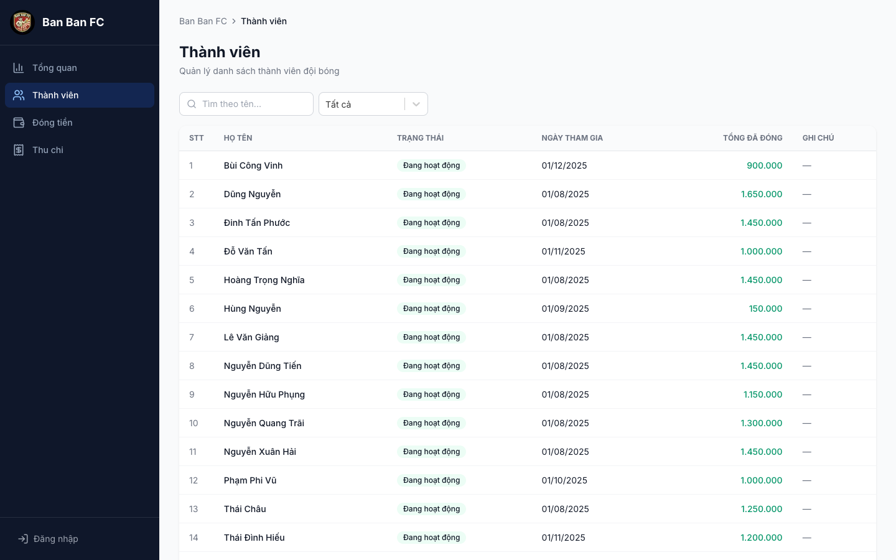

#### Admin — Quản lý thành viên
Có nút "+ Thêm thành viên", dropdown đổi trạng thái trực tiếp, icon sửa/xóa mỗi dòng.

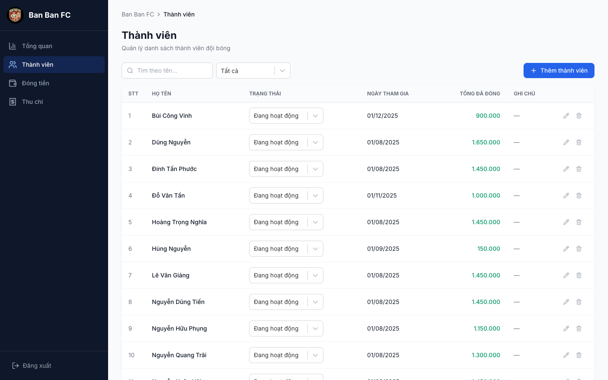

#### Admin — Thêm thành viên mới
Form modal nhập họ tên, chọn trạng thái và ghi chú.

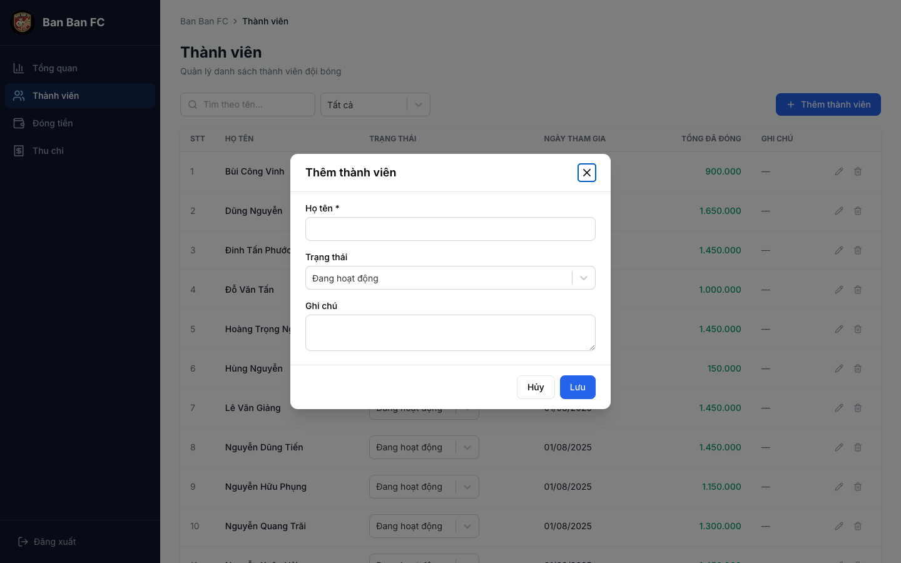

---

#### Thành viên — Xem bảng đóng tiền (chỉ đọc)
Xem ai đã đóng tháng nào, nhưng không thao tác được.

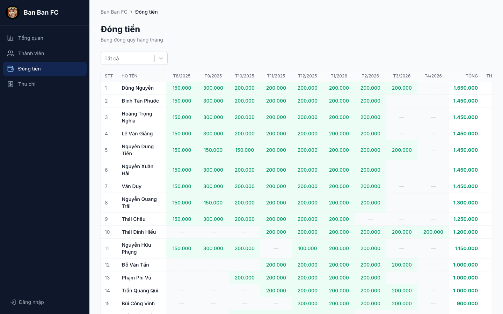

#### Admin — Bảng đóng tiền + Ghi nhận thanh toán
Admin có nút "+" thêm tháng mới. Click vào ô trống mở modal ghi nhận đóng tiền.

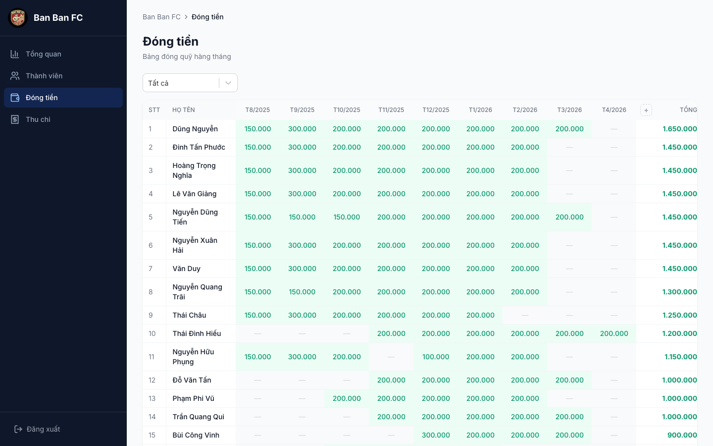

#### Admin — Ghi nhận đóng tiền
Chọn tháng, số tiền (mặc định 200.000), ghi chú. Hệ thống tự tạo giao dịch thu tương ứng.

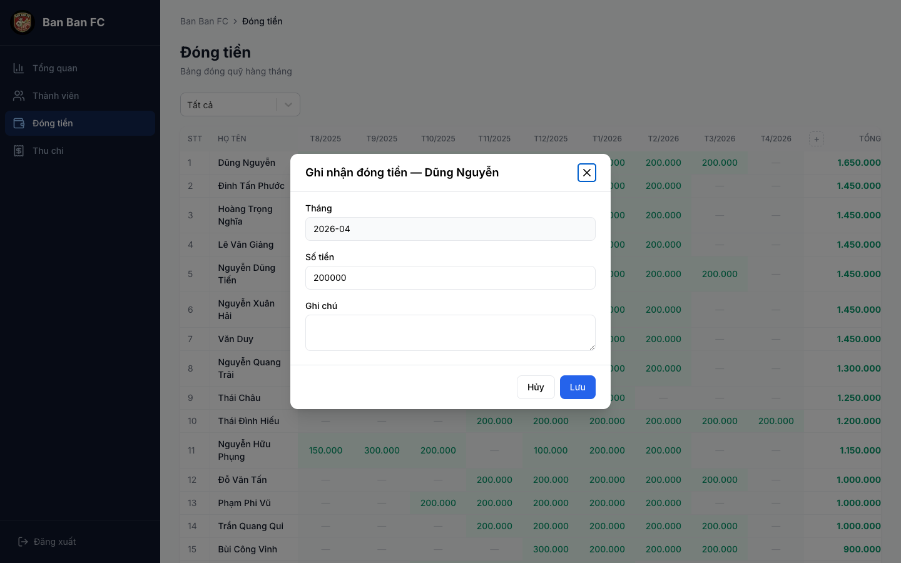

---

#### Thành viên — Xem sổ thu chi (chỉ đọc)
Xem toàn bộ giao dịch và số dư, nhưng không thêm/sửa/xóa được.

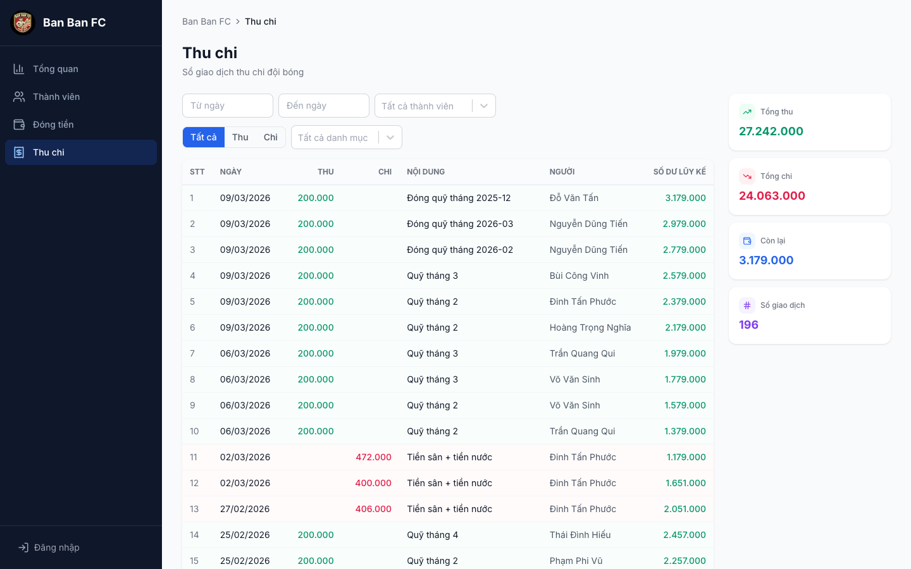

#### Admin — Sổ thu chi + Thao tác
Admin có nút "+ Thêm giao dịch", icon sửa/xóa mỗi dòng.

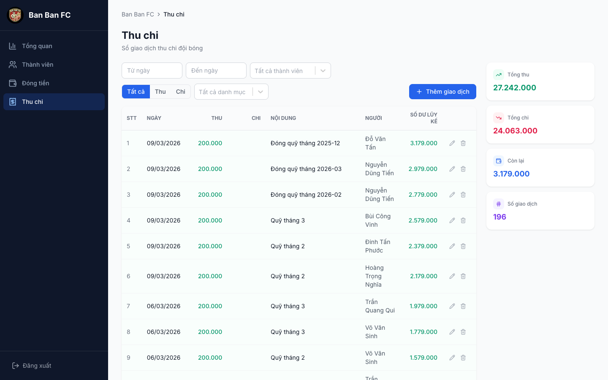

#### Admin — Thêm giao dịch
Form đầy đủ: ngày, loại (Thu/Chi), số tiền, danh mục, nội dung, thành viên liên quan.

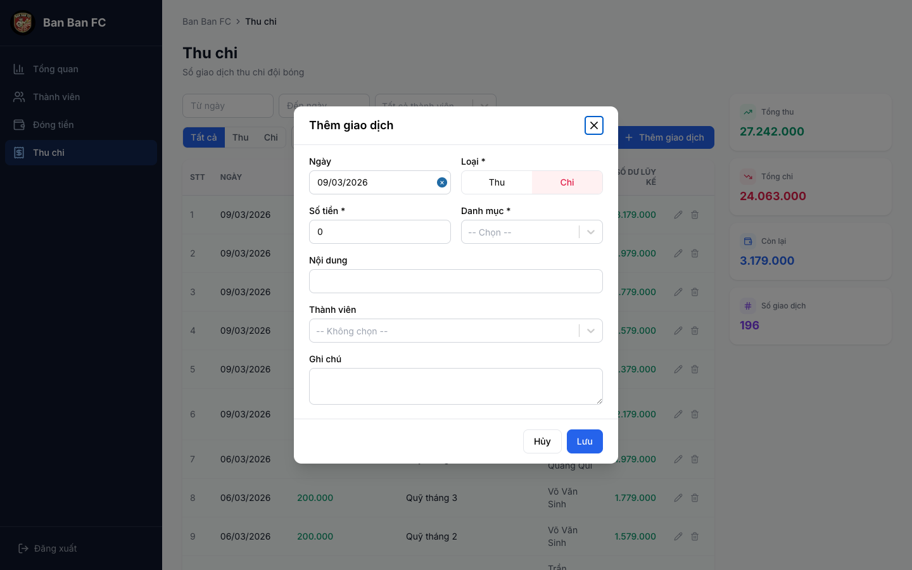

---

### Giao diện Mobile
Dưới 768px, ứng dụng hiển thị giao diện riêng cho điện thoại (thanh điều hướng dưới, dạng thẻ và bottom sheet) thay vì chỉ co giãn bản desktop.

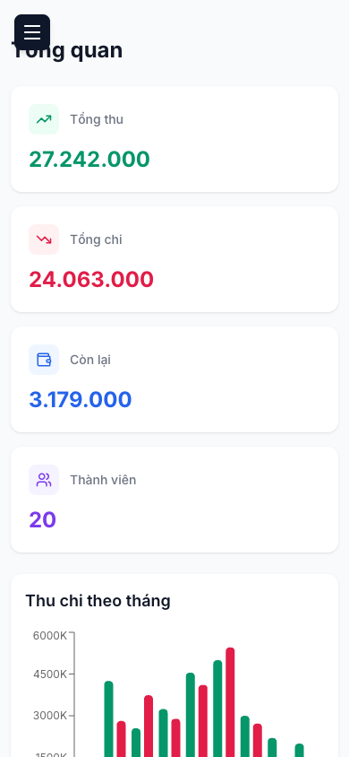

## Tính năng chính

| Tính năng | Mô tả |
|-----------|-------|
| **Dashboard** | Tổng thu, tổng chi, số dư, biểu đồ theo tháng, giao dịch gần đây. Admin xem thêm thống kê tiền vào/ra ngân hàng theo tháng |
| **Thành viên** | CRUD, tìm kiếm, lọc trạng thái, xem tổng đã đóng. Admin lưu tên chuyển tiền / số tài khoản để khớp giao dịch ngân hàng |
| **Đóng tiền** | Ma trận thành viên × tháng, ghi nhận nhanh, đánh dấu tháng nghỉ, tự tạo giao dịch thu |
| **Mức quỹ theo tháng** | Admin đặt mức quỹ áp dụng từ một tháng (mặc định 200.000đ), không hardcode |
| **Thu chi** | Sổ cái đầy đủ, số dư lũy kế, bộ lọc đa chiều, danh mục thu/chi |
| **QR chuyển tiền** | Upload mã QR ngân hàng, sao chép số TK, tải ảnh, chia sẻ qua Zalo (có ảnh xem trước link) |
| **Tự ghi nhận chuyển khoản** | Webhook SePay nhận giao dịch của tài khoản quỹ, tự khớp thành viên và chia vào các tháng; giao dịch chưa khớp vào hàng chờ cho admin xử lý |
| **Thông báo Zalo** | Zalo Bot báo kết quả ghi nhận và cảnh báo lỗi |
| **Realtime** | Trang tự làm mới khi dữ liệu thay đổi (Supabase Realtime) |
| **Bảo mật** | Đăng nhập admin, RLS trên database, `requireAdmin()` cho mọi thao tác ghi; dữ liệu ngân hàng chỉ admin đọc được |

## Tech Stack

- **Framework**: Next.js 14 (App Router) + React 18 + TypeScript (strict)
- **Styling**: Tailwind CSS v3
- **Database**: Supabase (PostgreSQL + Row Level Security + Realtime)
- **Auth**: Supabase Authentication (email/password, quyền admin qua `app_metadata.is_admin`)
- **Forms**: React Hook Form + Zod validation
- **Charts**: Recharts
- **Date**: date-fns (Vietnamese locale)
- **Tích hợp**: SePay (webhook ngân hàng), Zalo Bot, Upstash Redis (tùy chọn), Vercel Cron

## Cài đặt

### Yêu cầu
- Node.js 18+
- Supabase project (free tier đủ dùng)

### Bước 1: Clone & cài dependencies
```bash
git clone <repo-url>
cd banbanfc
npm install
```

### Bước 2: Cấu hình môi trường
```bash
cp .env.local.example .env.local
```

| Biến | Bắt buộc | Mô tả |
|------|----------|-------|
| `NEXT_PUBLIC_SUPABASE_URL` | ✅ | URL project Supabase |
| `NEXT_PUBLIC_SUPABASE_ANON_KEY` | ✅ | Anon key |
| `SUPABASE_SERVICE_ROLE_KEY` | ✅ | Service role key (chỉ dùng cho webhook/script) |
| `SEPAY_WEBHOOK_API_KEY` | Khi dùng SePay | API key xác thực webhook (mỗi môi trường một key) |
| `FUND_BANK_ACCOUNT` | Khi dùng SePay | Số tài khoản quỹ; giao dịch tài khoản khác bị bỏ qua |
| `FUND_ACCOUNT_HOLDER_NAME` | Khi dùng SePay | Tên chủ tài khoản quỹ, loại khỏi nội dung khi khớp người gửi |
| `ZALO_BOT_TOKEN`, `ZALO_CHAT_ID` | Tùy chọn | Gửi thông báo qua Zalo Bot |
| `UPSTASH_REDIS_REST_URL`, `UPSTASH_REDIS_REST_TOKEN` | Tùy chọn | Chỉ cảnh báo một lần cho mỗi webhook lỗi |
| `CRON_SECRET` | Khi deploy Vercel | Bảo vệ cron giữ Supabase free không bị tạm dừng |

### Bước 3: Tạo database
Trong Supabase SQL Editor, chạy lần lượt các file trong `supabase/migrations/`:

```
001_create_tables.sql
002_rls_policies.sql
003_tighten_rls_admin_role.sql
004_qr_codes.sql
005_bank_auto_contributions.sql
006_backfill_leave_months.sql   # tùy chọn: đánh dấu tháng cũ chưa đóng là "Nghỉ"
007_monthly_fees.sql
```

Không có migration runner — thay đổi schema mới thêm vào file đánh số tiếp theo.

### Bước 4: Tạo tài khoản admin
Tạo user trong Supabase Auth, sau đó cấp quyền admin:
```sql
update auth.users
set raw_app_meta_data = raw_app_meta_data || '{"is_admin": true}'
where email = 'admin@example.com';
```

### Bước 5: Chạy
```bash
npm run dev
```
Mở http://localhost:3000 và đăng nhập.

### Deploy
Dự án deploy trên Vercel (`vercel.json` khai báo cron `/api/cron/keepalive` chạy hằng ngày). Build local:
```bash
npm run build && npm start
```

Thiết lập SePay + Zalo Bot cho production: xem [`docs/huong-dan-sepay-zalo.md`](docs/huong-dan-sepay-zalo.md).

## Lệnh hữu ích

| Lệnh | Mô tả |
|------|-------|
| `npm run dev` | Dev server tại http://localhost:3000 |
| `npm run build` | Build production (kiêm kiểm tra TypeScript) |
| `npm run lint` | ESLint |
| `npm test` | Unit test (`lib/**/*.test.ts`, logic ngân hàng) |
| `npx tsx scripts/import-csv.ts --dry-run` | Nhập dữ liệu cũ từ bảng tính (bỏ `--dry-run` để ghi thật) |
| `npx tsx scripts/simulate-sepay-webhook.ts --content "..." --amount 200000` | Gửi webhook SePay giả lập vào app đang chạy |
| `npx tsx scripts/zalo-get-chat-id.ts` | Lấy `chat_id` cho Zalo Bot |
| `npx tsx scripts/seed-bank-demo.ts --confirm-ref <staging-ref>` | Tạo dữ liệu ngân hàng demo (`--clean` để xóa). **Không chạy trên production** |

## Kiến trúc

```
Người dùng → Next.js (Server Components + Server Actions)
                ↓
           Supabase Auth (xác thực)
                ↓
           PostgreSQL + RLS (dữ liệu)
                ↑
SePay ──webhook──→ /api/webhooks/sepay → khớp thành viên → chia tháng → Zalo Bot
```

- **Server Components** lấy dữ liệu, **Client Components** xử lý tương tác
- **Server Actions** với `requireAdmin()` bảo vệ mọi thao tác ghi
- **Zod** validate dữ liệu cả client và server
- Khi ghi nhận đóng quỹ → tự động tạo giao dịch tương ứng
- **Mobile/Desktop**: mỗi trang có component `*-switch.tsx` chọn giao diện desktop hoặc mobile (`components/mobile/`)
- **Webhook SePay**: lưu giao dịch thô (idempotent), khớp người gửi theo số TK rồi tên chuyển tiền, chỉ tự ghi khi số tiền bằng đúng mức quỹ của tháng đầu tiên cần đóng; còn lại vào hàng chờ "Giao dịch ngân hàng" ở trang Đóng tiền. Admin có thể hủy ghi nhận để đưa giao dịch về hàng chờ

## Database

| Bảng | Mô tả |
|------|-------|
| `members` | Thành viên (tên, trạng thái, ngày tham gia) |
| `contributions` | Đóng quỹ hàng tháng (thành viên, tháng, số tiền) |
| `transactions` | Thu chi (ngày, loại, số tiền, danh mục, mô tả) |
| `member_leaves` | Tháng nghỉ của thành viên (không tính nợ) |
| `monthly_fees` | Mức quỹ áp dụng từ một tháng |
| `qr_codes` | Mã QR chuyển khoản (ngân hàng, số TK, ảnh) |
| `member_bank_identities` | Tên chuyển tiền / số TK của thành viên — **chỉ admin** |
| `bank_transactions` | Giao dịch thô từ SePay và trạng thái xử lý — **chỉ admin** |

## Roadmap

- [x] Mã QR chuyển khoản + chia sẻ Zalo
- [x] Giao diện mobile riêng
- [x] Tự ghi nhận chuyển khoản qua SePay + thông báo Zalo
- [x] Mức quỹ cấu hình theo tháng
- [ ] Export Excel/CSV
- [ ] Bulk import thành viên
- [ ] Báo cáo đối soát hàng tháng
- [ ] Ảnh chụp hóa đơn
- [ ] Quy trình duyệt chi

## Tài liệu

- [`docs/huong-dan-sepay-zalo.md`](docs/huong-dan-sepay-zalo.md) — thiết lập và vận hành SePay + Zalo Bot
- [`docs/system-architecture.md`](docs/system-architecture.md) — kiến trúc hệ thống
- [`docs/code-standards.md`](docs/code-standards.md) — quy ước code
- [`docs/INDEX.md`](docs/INDEX.md) — mục lục tài liệu

## License

Internal use only — Ban Ban FC.

---

**Cập nhật**: Tháng 11, 2026
